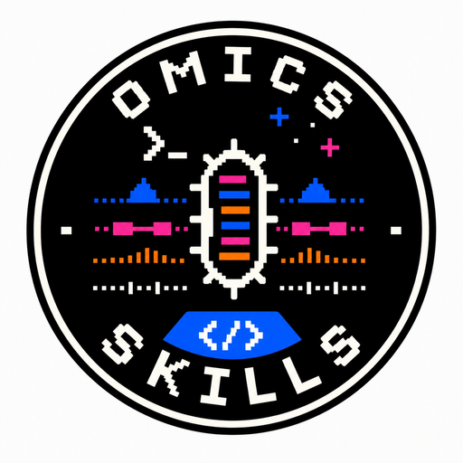

<p align="center">
  
</p>

<p align="center">
  <a href="https://github.com/fmschulz/omics-skills/releases">
    
  </a>
  <a href="https://github.com/fmschulz/omics-skills/actions/workflows/ci.yml">
    
  </a>
</p>

A small skill pack for omics pipelines, literature discovery, notebooks, and data visualization. Works with Claude Code and the Codex CLI.

## Documentation

Read the docs at <https://fmschulz.github.io/omics-skills/>. They cover installation, the skills, the agent, and development.
Release notes are published on the [GitHub Releases page](https://github.com/fmschulz/omics-skills/releases).

## Scope

The pack holds twelve skills and one agent. It keeps what a current model cannot derive: house rules for running and reporting an analysis, tools the pack maintains, a hosted full-text literature corpus, and small tested helpers. It leaves out manuals for standard tools.

| Skill | Purpose |
|---|---|
| `omics-pipeline` | Entry for pipeline work: the shared rules, and one decision page each for read QC and mapping, assembly, binning, gene calling, phylogenomics and structure |
| `tracking-taxonomy-updates`, `bio-annotation`, `bio-viromics`, `bio-interdomain-hgt` | Stage skills with scripts: domain routing and taxonomy, annotation, viromics, interdomain HGT |
| `bioinformatics-project` | Project layout, pinned environment, restartable drivers, provenance |
| `polars-dovmed`, `crossref-lookup`, `public-db-lookup` | Full-text literature search, DOI and citation metadata, public database records |
| `bio-logic` | Hypothesis register and claim-against-evidence checks |
| `notebooks`, `beautiful-data-viz` | Executed notebooks and figures |

The four stage skills are hidden from the skill list, so their descriptions cost no prompt space; `omics-pipeline` names them. Manuscript prose (`academic-writing` with `stop-slop`), manuscript review (`nelli-paper-review`), PDF conversion (`pdf-to-md`) and claim-graph extraction (`csag-extraction`) come from other repositories.

The agent, `literature-expert`, is a Markdown prompt. Installation links that file for Claude Code and renders a TOML agent definition for Codex.

## How Analyses Are Run

The pipeline stages share a few rules, stated once in `skills/omics-pipeline/SKILL.md`, that make exploratory analyses easier to audit and reproduce:

- **Hypothesis register.** Exploratory work starts with at least five working hypotheses (biological mechanism, technical artifact, null, sampling or batch effect, database artifact). Each is revised as supported, weakened, ruled out, or unresolved, with the evidence that changed its status.
- **Reflection after each step.** After each major result or QC gate, the agent records what was observed, which hypotheses gained or lost support, and the next discriminating check.
- **Literature-derived analysis plan.** Before deciding what is "interesting" the agent reads the literature for the inferred group and summarises which markers, comparison sets, plots, and outliers are diagnostic.
- **Comparative axes against close relatives.** When relatives are available, the query is run through five axes (genome-property frontier, marker-gene census, per-family copy number, conserved neighborhoods, and non-coding RNA census), and each axis gets a comparison table.
- **Literature search.** `polars-dovmed` queries PMC and bioRxiv through the connector, the hosted API, or a local parquet `dovmed scan`. An outage is reported, never skipped silently.
- **Findings table.** A report ends with a table of candidates, each with its evidence, confidence, comparison baseline, literature context and follow-up test. Negative findings are stated.

## Tooling baseline

The default tool per pipeline step and the version each command was checked against are in [`docs/tooling-survey-2026.md`](docs/tooling-survey-2026.md). A version in a skill records what was checked; it is not an install pin.

## Installation

### Claude Code / Cowork Plugin Marketplace

This repository is packaged as a Claude Code / Cowork plugin marketplace. To test the marketplace directly from GitHub:

```bash
claude plugin marketplace add fmschulz/omics-skills
claude plugin install omics-skills@omics-skills
```

To test a local checkout before submitting or publishing changes:

```bash
claude plugin validate .
claude plugin marketplace add ./
claude plugin install omics-skills@omics-skills
```

After Anthropic approves the community marketplace submission, users can install it from the public Claude plugin catalog.

### Codex Plugin Marketplace

The repository also includes a native Codex plugin manifest and repo marketplace:

```bash
codex plugin marketplace add fmschulz/omics-skills
codex plugin add omics-skills@omics-skills
```

For a local checkout, replace `fmschulz/omics-skills` with `.`. Run `codex plugin list --available --json` to inspect the resolved plugin before installing it.

### Makefile

```bash
git clone https://github.com/fmschulz/omics-skills.git
cd omics-skills
make install
```

`make install` installs skills under `~/.agents/skills`, links the Claude agent, and renders the Codex agent as TOML. Use `make install-claude` or `make install-codex` for one runtime, `make install INSTALL_METHOD=copy` for copied skills, and `make status` to inspect the result. Re-run the installer after changing the agent prompt, because a rendered TOML file does not follow the Markdown source. See [docs/INSTALL.md](docs/INSTALL.md) for troubleshooting and for the upgrade from 1.x.

## Usage

A session needs no agent: the model loads a skill when its description fits the task. Name a skill to load it directly, as `/<skill-name>` in Claude Code or `$<skill-name>` in Codex, hidden stage skills included. For pipeline work, start with `omics-pipeline`.

For a literature task in its own context, start the agent:

```bash
claude --agent literature-expert
```

In Codex, ask the primary agent to delegate to `literature-expert`; the rendered definition under `~/.codex/agents/` is available as a custom subagent.

## Repository layout

```
agents/                     the agent definition
skills/                     skill directories; each has a SKILL.md
Makefile                    the installer: install, uninstall, status, validate, test
scripts/
  render_codex_agent.py     Markdown agent -> Codex TOML
  prune_removed_skills.py, prune_removed_agents.py
                            retire skills and agents dropped from the checkout
  validate-skills.py, validate-supplementary-docs.py, validate-citations.py
  citation-cache.json       registered Crossref records that validate-citations.py checks
  check_tool_versions.py    report of tool guides behind the newest release
  check_release_sync.py     tag, manifest and release-note check before a release
tests/                      unit and fixture tests, one file per script or skill
validation/                 truth-set registry and Slurm job harness for biological validation
docs/                       MkDocs site sources (install, skills, agent, validation, tooling, contributing)
```

## Development

```bash
uv run --no-project --with pytest --with requests --with PyYAML python -m pytest tests -q
```

Adding or modifying a skill:

1. Create or edit `skills/<name>/SKILL.md`. The YAML `name` field must match the directory name.
2. For a pipeline stage, add its page or stage skill to the tables in `skills/omics-pipeline/SKILL.md`.
3. Run `make test`.

See [AGENTS.md](AGENTS.md) for structural conventions, [docs/CONTRIBUTING.md](docs/CONTRIBUTING.md) for contribution flow, and [docs/skills.md](docs/skills.md) for the public skill catalog.

## Compatibility

| Platform | Notes |
|---|---|
| Claude Code | Agent in `~/.claude/agents/`; skills in `~/.claude/skills/`. |
| Codex CLI | TOML subagent in `~/.codex/agents/`; canonical skills in `~/.agents/skills/` with a legacy `~/.codex/skills` link; native plugin metadata in `.codex-plugin/`. |
| Claude API | The agent Markdown file loads directly as a system prompt; skill files are readable as reference. |

## License

MIT. See [LICENSE](LICENSE).
